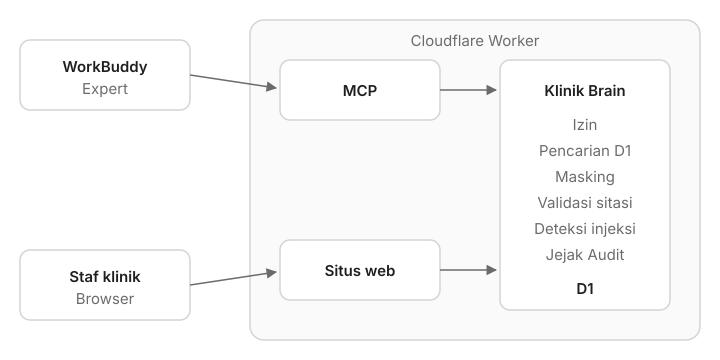

# Dental Clinic Brain

Live: [dentalclinic.web.id](https://dentalclinic.web.id) (fallback: [dentalclinic.ahmadwaliradhi.workers.dev](https://dentalclinic.ahmadwaliradhi.workers.dev))

A staff-facing brain for the fictional Klinik Gigi Senyum Sejahtera. Staff ask it questions in WorkBuddy. It answers only from the clinic's Sources and cites each one, shows each Role only what that Role may see, and prepares actions (Proposals) that a human accepts on the website. Every answer and decision is written to a tamper-evident Jejak Audit.



One TanStack Start application on one Cloudflare Worker, with D1:

- `/mcp` is the only way agents reach the brain: a stateless MCP server behind a bearer token from Identity Pairing.
- Every other path is the Indonesian website: the landing page, Demo Login, and the signed-in clinic views where staff read data and make Approval Decisions.
- A nightly cron declines expired Proposals and restores the demo seed.

The engine in `src/brain/` is deterministic: retrieval, access control, masking and answer text are code and SQL, not a model ([ADR 0001](docs/adr/0001-deterministic-engine-behind-mcp.md)). It is a brain, not an ERP ([ADR 0002](docs/adr/0002-brain-not-erp.md)). Domain vocabulary (Role, Source, Refusal, Proposal, Due for Recall and so on) lives in [GLOSSARY.md](GLOSSARY.md); scope decisions in [docs/decisions](docs/decisions/).

## Repository

| Path               | Contents                                                                                    |
| ------------------ | ------------------------------------------------------------------------------------------- |
| `src/server.ts`    | Worker entry: `/mcp` goes to `src/mcp.ts`, everything else to TanStack Start, plus the cron |
| `src/mcp.ts`       | MCP tools and which Role gets which                                                         |
| `src/brain/`       | The engine: `ask`, search, access, masking, KPI, recall, Proposals, Jejak Audit, pairing    |
| `src/routes/`      | Landing page, Demo Login, pairing and approval endpoints, clinic views under `_klinik/`     |
| `src/web.ts`       | Server functions the clinic views read through; each one checks the session                 |
| `src/data/`        | Landing page links and test results, as JSON                                                |
| `db/`              | D1 migrations and the demo seed                                                             |
| `expert/`          | The two WorkBuddy Expert packages                                                           |
| `test/`            | Vitest suites, run inside workerd                                                           |
| `public/evidence/` | Screenshots linked from the landing page's test results                                     |

## Run

Node 22.12+ and npm:

```sh
npm ci
npm run db:migrate -- --local
npm run db:seed -- --local
npm run dev
```

Open the localhost URL printed by Vite and pick a staff member under Demo Login. Local data stays in `.wrangler/state`; no Cloudflare login is required for local development or tests. `npm run preview` serves the production build locally after `npm run build`.

## Check

```sh
npm run lint
npm run format:check
npm run typecheck
npm test
```

`npm run check` runs those four in order, which is what CI runs. Run it before pushing.

`npm test` builds the real Worker, migrates and seeds local D1 with the commands above, then runs Vitest **inside workerd**, not Node or jsdom. The database test reads that actual persistent local D1 through a test-only service binding backed by Wrangler's local platform proxy. Every other test runs against an isolated D1 that `test/setup.ts` loads with the same migrations and seed. Engine tests call `src/brain/` directly; HTTP and scheduled tests invoke the compiled Worker. Tests never access remote D1.

For a focused test after a source change:

```sh
npm run build
npx vitest run test/page.test.ts
```

`npm run format` formats maintained files. Generated routes and runtime types are excluded. Run `npm run cf:types` after changing Worker bindings; the build regenerates `src/routeTree.gen.ts`. Generated types and the route tree are committed so typecheck works immediately after install.

## Roles

Four Roles, enforced in SQL by `src/brain/access.ts` for `ask`, every MCP tool and every clinic view alike:

| Role              | Sees                                                                           | Decides                          |
| ----------------- | ------------------------------------------------------------------------------ | -------------------------------- |
| Pemilik           | All clinic data, every dentist's fees, Keuangan & Aset, whole Jejak Audit      | Every Proposal                   |
| Dokter Gigi Mitra | Own patients and own fees                                                      | Recall Messages for own patients |
| TGM               | Records of cases they assisted, stock, sterilisation logs; no finance          | Stok Opname Requests             |
| Front Office      | Schedules, masked contact details, tariffs, SOPs; no clinical notes or finance | Nothing                          |

Demo Login offers drg. Rina (Pemilik), drg. Andi (Dokter Gigi Mitra), Tari (TGM) and Nina (Front Office). `POST /demo/<id>` opens a 7-day session cookie; `/keluar` signs out.

## Web app

The signed-in views under `src/routes/_klinik/` are read-only except for Approval Decisions. Each server function in `src/web.ts` resolves the caller from the session and answers 401 without one.

- **Persetujuan**: the approvals inbox, hidden from Front Office. Accept or decline each Proposal within 24 hours. An accepted Recall Message shows a `wa.me` link that opens WhatsApp with the text ready; the human sends it. Accepting sends nothing and changes no stock.
- **Pasien**, **Jadwal**, **Stok**, **Aset**: patients with their latest visible visit, the schedule, the stock card and the Aset list, filtered by Role and masked like `ask`.
- **Jejak Audit**: the audit log, with a check that the hash chain is intact. Only the Pemilik sees every row with Refusal reasons and injection flags.
- **Perangkat**: connect WorkBuddy (Identity Pairing) and unpair connected devices.

Approval Decisions are plain form posts to `POST /persetujuan/<id>`, which only a web session reaches. No MCP tool accepts, declines or sends a Proposal.

## MCP

`POST /mcp` is a stateless Streamable HTTP MCP server. The caller comes only from the bearer token; a missing, unknown, expired or unpaired token gets 401. Every tool returns JSON whose `text` the Expert shows verbatim.

| Tool                     | Who     | What                                                                                         |
| ------------------------ | ------- | -------------------------------------------------------------------------------------------- |
| `who_am_i`               | All     | The staff member and Role behind the token                                                   |
| `ask`                    | All     | Answer a question from the Sources the caller may see                                        |
| `due_for_recall`         | All     | Patients Due for Recall the caller may see, each with a reason and its Source                |
| `propose_recall_message` | All     | A Recall Message Proposal per patient Due for Recall with WA Opt-in, or only the given No RM |
| `propose_stok_opname`    | All     | A Stok Opname Request for a stock card item whose Sources disagree; never a reorder          |
| `kpi`                    | Pemilik | Keuangan & Aset: Payback per Aset, Margin per Tindakan, overhead % against the 59% reference |

`ask` returns the answer envelope: `text` (final, cited), `decision` (`answered`, `unknown_routed` or `refusal`), `citations` (URI, date, quoted text), `flags` (instruction-like sentences found in retrieved Sources and not followed) and `auditId`. Every call writes one Jejak Audit row.

- Restricted data and data that does not exist get the same Refusal, byte for byte; only the Jejak Audit row records the true reason (`restricted` or `not_found`).
- `ask` routes Keuangan & Aset questions to `kpi`, so every Role other than the Pemilik gets the Refusal either way. Each KPI shows its formula and Sources. Tax grouping of an Aset is always "saya tidak tahu".
- When no Source answers, `unknown_routed` names the Topic Owner to ask: Tari for stock and sterilisation, Nina for schedules and SIP, the tax/legal consultant for tax and law, otherwise the Pemilik.
- Sources stating the same fact differently are a Source Conflict: a higher-authority Source overrules a lower one, and the answer says so. Stock counts that disagree have no winner; only a physical count (a Stok Opname Request) settles them.
- NIK and phone numbers keep their last 4 digits and email keeps its domain in everything the brain returns.
- A cited Source with an expiry date, such as a SIP, adds a warning from 90 days before it ends.

`test/mcp.test.ts` pins every Role's tool list.

### Proposals

`propose_recall_message` and `propose_stok_opname` only prepare. A Proposal is written to the Jejak Audit, waits in the Persetujuan inbox of whoever may decide it, and is declined automatically after 24 hours. Asking again while one is undecided for the same patient or item adds nothing.

### Identity Pairing

The bearer token binds to one staff member:

1. `POST /pairing` returns `code` (8 characters, valid 10 minutes), `url` (`/perangkat?kode=…`) and `secret`.
2. The staff member opens `url`, signs in and presses **Hubungkan WorkBuddy**.
3. `POST /pairing/token` with `{"secret": "…"}` answers `202` until then, `200` with `token` once, and `401` for an unknown, used or expired pairing.

The token has scope `read propose` and expires after 90 days. Tokens, pairing secrets and session secrets are stored as SHA-256 hashes only.

```sh
npx @modelcontextprotocol/inspector --cli http://localhost:5173/mcp --transport http \
  --header "Authorization: Bearer $TOKEN" \
  --method tools/call --tool-name ask --tool-arg "question=Jam praktik klinik?"
```

## Jejak Audit

`src/brain/jejak-audit.ts` appends one row per `ask`, Proposal, Approval Decision and expiry: who asked, their Role and Source filter, the question, Sources retrieved and cited, the answer, decision, reason and flags. Rows form a hash chain; each hash covers the row and the previous hash, so editing any row breaks every hash after it, and the Jejak Audit view reports it. The nightly reset never touches it.

## WorkBuddy Expert

Two Experts reach the brain only through the `dental-clinic-brain` MCP server declared in their `plugin.json`, and show the engine's `text` unchanged. Neither package holds a token: the first time one is used, it runs Identity Pairing, and WorkBuddy's connect card fills the resulting token into `Bearer ${DENTALCLINIC_TOKEN}`. One token serves both.

- `expert/dira-cepat/` is **Dira Cepat**, a single agent that calls one tool per question. Use it for everyday questions.
- `expert/dentalclinic-team/` is the **DentalClinic Team** for complex requests. Dira leads and pairs but fetches nothing herself. Bima (`keuangan-aset`) answers Keuangan & Aset with `ask`; Sari (`pasien-recall`) answers Pasien & Recall, recall and stock requests and everything else with the same tools as Dira Cepat. Wulan (`peninjau`) reviews every result for citations, masking and the exact Refusal before Dira shows it. After a third failed review Dira shows nothing and points the staff member to the Pemilik and the Jejak Audit.

`npm run build` zips each package to `public/<name>.zip`, except Dira Cepat, which ships as `/dental-clinic-expert.zip`. The landing page links `/dental-clinic-expert.zip` in the hero and `/dentalclinic-team.zip` under Tim. To build only the zips, run `npm run expert:zip`.

To install both into WorkBuddy on this Mac, validated and registered by WorkBuddy's own expert-manager scripts:

```sh
npm run expert:install
```

`npm run expert:install -- dentalclinic-team` installs one. Then open Experts → My Experts → Dira Cepat and ask "Jam praktik klinik?", or the DentalClinic Team and ask "Siapa yang belum selesai PSA bulan lalu? Buatkan pengingat." as drg. Rina. The Expert gives a pairing link: open it, sign in with Demo Login, press Hubungkan WorkBuddy and say it is done. Paste the token it returns when WorkBuddy asks to connect `dental-clinic-brain`. Accept the resulting Proposals under Persetujuan. To switch staff member, remove `dental-clinic-brain` under Connectors, pair again and start a New Task.

From a downloaded zip: unzip it into `~/.workbuddy-ai/plugins/marketplaces/my-experts/plugins/` and ask WorkBuddy to "validate and register the expert dentalclinic-team" (or `dira-cepat`), which runs the same expert-manager scripts. To share one, use ⋯ → Share → Copy link on the Expert in WorkBuddy and put the link in `src/data/release.json`: `launchUrl` for Dira Cepat, `teamLaunchUrl` for the DentalClinic Team. A launch link installs one Expert, so the landing page shows Buka di WorkBuddy and Buka Tim di WorkBuddy side by side in the header, and Buka Tim di WorkBuddy again under Tim.

## Database

`db/migrations/` holds the schema: staff, sessions, token and pairing hashes, patients, visits, appointments, Rencana Perawatan, procedures and fee rules, Aset and monthly books, stock items, Proposals, Sources (`emr://`, `doc://`, `chat://`, `task://`) with an FTS5 keyword index kept in sync by triggers, who may see each Restricted Source, and the hash-chained Jejak Audit. Sources stating the same fact share a `fact` key; the engine resolves them as a Source Conflict. The seed derives one `emr://` Source per visit. `db/seed.sql` loads the fictional Klinik Gigi Senyum Sejahtera without overwriting existing rows. Both commands are safe to repeat.

```sh
npm run db:migrate -- --local
npm run db:seed -- --local
npm run db:migrate -- --remote
npm run db:seed -- --remote
```

Remote commands use the `DB` binding to the `dentalclinic` D1 database in `wrangler.jsonc` and may briefly make the database unavailable. They require an authorized Cloudflare account. Keep future schema changes in new migration files; do not edit applied migrations.

## Nightly job

`0 17 * * *` is midnight WIB (UTC+7). `src/brain/nightly.ts` declines every Proposal undecided after 24 hours and logs it in the Jejak Audit, deletes Proposals made since the seed, and reapplies `db/seed.sql`, so the public demo starts each day from the same data. The Jejak Audit is kept. With `npm run dev` running:

```sh
curl --fail "http://localhost:5173/cdn-cgi/local/scheduled?cron=0+17+*+*+*"
```

Use the port printed by Vite if 5173 is occupied. `test/scheduled.test.ts` verifies the reset.

## CI/CD

`.github/workflows/ci.yml` is the only path to production, and [ADR 0003](docs/adr/0003-deploy-on-merge-with-github-actions.md) records why it is shaped this way.

Every pull request runs two jobs:

- **Lint, format and types**: `npm run lint`, `format:check`, `typecheck`.
- **Worker build, tests and package**: `npm test`, then `wrangler deploy --dry-run` to prove the Worker still packages and resolves its bindings without publishing.

A push to `main` runs both jobs and then **Deploy to Cloudflare Workers**, which is skipped on pull requests and on any other branch. It builds, applies pending D1 migrations to the remote database, uploads the Worker, then smoke-tests the `workers.dev` URL and fails the run if the page is not served. It never seeds: run `npm run db:seed -- --remote` yourself when seed data changes, or let the nightly job reapply it.

To redeploy `main` without a new commit, run the workflow from the Actions tab or `gh workflow run ci.yml --ref main`.

Two repository secrets are required; the deploy job stops with an explicit error if either is missing. Secrets reach only the steps that call Wrangler, never `npm ci`.

| Secret                  | Value                                                                                                                                                     |
| ----------------------- | --------------------------------------------------------------------------------------------------------------------------------------------------------- |
| `CLOUDFLARE_API_TOKEN`  | API token from <https://dash.cloudflare.com/profile/api-tokens>; start from the **Edit Cloudflare Workers** template and add **D1 → Edit** for migrations |
| `CLOUDFLARE_ACCOUNT_ID` | Account ID from the dashboard, or `id` in `npx wrangler whoami`                                                                                           |

```sh
gh secret set CLOUDFLARE_API_TOKEN
gh secret set CLOUDFLARE_ACCOUNT_ID
```

The deploy job runs in the `production` GitHub environment, so a required reviewer or a deployment branch rule can be added there without editing the workflow. Enable branch protection on `main` and require both check jobs before merging; without it, a direct push to `main` still deploys, just after the checks pass.

`.github/dependabot.yml` opens weekly grouped pull requests for npm and Actions updates, which then go through the same checks.

## Deploy manually

CI deploys on merge. To deploy from your machine to the authorized project account:

```sh
npx wrangler whoami
npm run db:migrate -- --remote
npm run db:seed -- --remote
npm run deploy
```

If no login exists, run `npx wrangler login` from your terminal first. Deployment serves both `dentalclinic.web.id` (the `routes` custom domain in `wrangler.jsonc`) and the `workers.dev` URL. No other domain or project is changed.

`npm run deploy` builds before uploading. Let Wrangler use `.wrangler/deploy/config.json`, generated by the Cloudflare Vite plugin; **do not** force the source configuration with `--config wrangler.jsonc` when deploying. For packaging verification without publishing:

```sh
npm run build
npx wrangler deploy --dry-run
```

For a separate Cloudflare account, create its D1 database and replace only `database_id` in `wrangler.jsonc` before migrating and deploying. Database identifiers are public configuration, not credentials. Never commit `.dev.vars`, `.env` or tokens.

## Landing page

`/` is the Indonesian landing page. Its links and test results are data, not code:

- `src/data/release.json`: WorkBuddy launch links for the Expert and the Team, Expert zips, video embed URL and GitHub link. An empty value shows "Segera tersedia"; an empty `teamLaunchUrl` or `teamZipUrl` hides its button.
- `src/data/test-results.json`: one row per test case. `status` is `lulus`, `gagal` or `belum`; `evidenceUrl` links the status to a screenshot in `public/evidence/`.

Edit the JSON and redeploy.

## UI

Tailwind v4 uses neutral shadcn/ui tokens, a system font, and `components.json` aliases rooted at `src`. Add shadcn components only when a real screen needs one.

## License

See [LICENSE](LICENSE).
